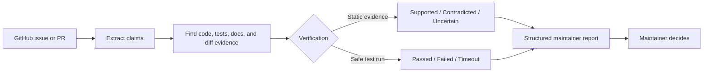
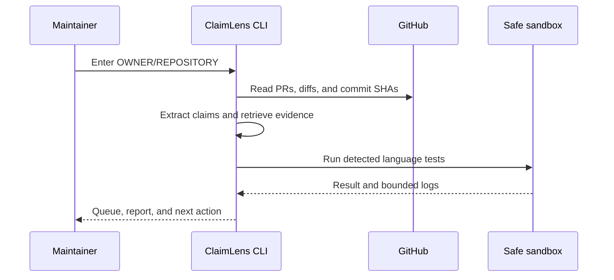

# ClaimLens

> **Turn PR claims into evidence a maintainer can inspect.**

[](https://github.com/Novax30/claimlens/actions/workflows/ci.yml)
[](https://www.python.org/)
[](LICENSE)

ClaimLens is a read-only CLI for open-source maintainers. It treats statements
in issues and pull requests as technical hypotheses, checks them against code,
tests, documentation, and PR diffs, and produces an evidence-linked report.
It recommends what to inspect; the maintainer makes the final decision.

## Why ClaimLens?

When a repository receives more PRs than a maintainer can read carefully, the
hard part is not opening another diff—it is deciding which technical claims
deserve attention first. ClaimLens creates a review map:

| You provide | ClaimLens returns |
| --- | --- |
| A repository and its PRs | A ranked review queue |
| Technical statements | Claim-by-claim assessments |
| Source, tests, and diffs | Exact evidence references |
| A testable PR | A safe pass/fail/timeout result |

It is an assistant, not an automatic merge or rejection bot.

## The whole idea in one picture



The key idea is simple: **AI suggests what to investigate; repository evidence
supports the result; the maintainer decides what happens next.**

## Try it in 60 seconds

```bash
git clone --branch main https://github.com/Novax30/claimlens.git
cd claimlens
./claimlens
```

Choose **1. Run the offline demo**. It needs no GitHub token, Docker, or Ollama
and writes a report to `reports/launcher_demo.md`.

## Quick start

Requirements: Python 3.9+ (3.10+ recommended), Git, and internet access for
first-time installation.

Important: Docker Desktop is required when ClaimLens executes untrusted PR
code. The offline demo, claim analysis, evidence search, and report generation
work without Docker. Ollama is optional.

Install Docker Desktop before using `claimlens verify`:

1. Download [Docker Desktop](https://www.docker.com/products/docker-desktop/).
2. Install it for your operating system.
3. Start Docker Desktop.
4. Confirm it is available:

```bash
docker --version
```

If Docker is not installed, ClaimLens refuses unsafe PR execution and reports
`environment_failure`. Trusted local code can be tested explicitly with
`--sandbox local`.

The launcher creates the environment and opens a small menu. Choose the offline
demo, a GitHub PR queue, or one PR verification.

For development setup:

```bash
python3 -m venv .venv
source .venv/bin/activate
python -m pip install -r requirements-dev.txt
python -m pip install --no-build-isolation --no-deps -e .
python -m pytest -q
```

After installation, the same operations are available through one CLI:

```bash
claimlens analyze input/example_request.json --offline
claimlens queue OWNER/REPOSITORY /path/to/checkout --no-llm
claimlens verify OWNER/REPOSITORY 123
claimlens evaluate examples/evaluation_dataset.json examples/sample_project --offline
```

## Ollama mode

Rules-only mode works without AI. For local open-weight model mode, install
[Ollama](https://ollama.com), then download both models:

```bash
ollama pull qwen2.5:7b
ollama pull deepseek-coder:6.7b
```

Qwen extracts claims. DeepSeek-Coder explains code evidence. ClaimLens sends
requests only to the local Ollama service. The client uses temperature `0` and
seed `42` for more repeatable outputs, but model output is still advisory.
These models need substantial disk memory; use rules-only mode on smaller
machines.

## Usage

Run the local demonstration:

```bash
./claimlens
```

Analyze a live PR queue with rules only:

```bash
python -m claimlens.github_queue_cli OWNER/REPOSITORY \
  --no-llm --workers 4
```

When no local checkout is provided, ClaimLens downloads a local cache at
`.claimlens-repos/OWNER-REPOSITORY`. Use `--refresh` to update that cache.
This changes only the local cache; it never updates the GitHub repository.

`--no-llm` means no Ollama; GitHub is still contacted. The older `--offline`
flag remains accepted for compatibility.

Set a token only when needed:

```bash
export GITHUB_TOKEN="your-token"
```

For public repositories, unauthenticated read access may work but is rate
limited. For a fine-grained token, use `Pull requests: Read-only` for queue
metadata. Fetching a private PR branch also needs `Contents: Read-only`.
ClaimLens never places the token in a clone URL, report, or child test process.

Verify one PR safely in Docker:

```bash
python -m claimlens.github_pr_verify_cli OWNER/REPOSITORY 123
```

The command fetches a PR into a temporary checkout and runs the detected
language profile in Docker with no network, a read-only repository mount, a
non-root numeric user, dropped capabilities, resource limits, and a timeout.
It never pushes, merges, comments, or changes the remote repository.

For local development only, host execution must be explicit:

```bash
python -m claimlens.verify_cli /path/to/repository --sandbox local
```

Do not use `--sandbox local` on untrusted contributor code.

## How it works



Each claim receives `supported`, `contradicted`, or `uncertain`. Execution is
separate: `passed`, `failed`, `timeout`, `blocked`, or `environment_failure`.
Failure to reproduce is never treated as proof that a report is false.

The language profiles currently detect Python, Rust, C/C++, JavaScript/
TypeScript, and Go. They select `pytest`, `cargo test`, CMake/CTest, `npm test`,
or `go test`. Missing toolchains are reported rather than silently installed.

## Example result

The useful output is not a mysterious score. It is a short trail from claim to
evidence:

```text
PR #42 — Fix timeout validation
Priority: medium | Status: needs_review

Claim: Negative timeout values are rejected
Assessment: supported
Confidence: high
Execution: passed
Evidence: src/config.py:12, tests/test_config.py:15
Recommendation: maintainer review
```

For an uncertain report, the result is explicit:

```text
Assessment: uncertain
Execution: not_attempted
Missing: reproduction steps, version information
Recommendation: ask the contributor for more detail
```

The report includes the repository commit, claim-level explanations, exact
evidence references, execution output, missing information, and limitations.

## Safety model

Issue text, PR text, patches, and repository files are untrusted data. Prompts
tell the models to treat them as data, structured JSON is validated, citations
must match supplied evidence, and model output cannot perform GitHub actions.

PR code is not run on the host by default. Docker verification uses
`--network none`, a read-only checkout, no credentials, no privileged user,
resource limits, and a disposable container. Docker is a stronger boundary
than a Python virtual environment; high-risk deployments should use a
disposable VM or hardened runner. Dependency installation from an untrusted PR
is not automatic.

## Evaluation

The included six-case demonstration dataset currently gives:

- 6/6 expected assessments
- 100% demonstration accuracy
- 100% evidence coverage

Run it with:

```bash
python -m claimlens.evaluation_cli \
  examples/evaluation_dataset.json examples/sample_project --offline
```

This is a small fixture, not a production benchmark. A serious evaluation
should use repository-separated historical issues, manual labels, false-
rejection rate, calibration, evidence coverage, and comparison of rules-only
versus model mode.

## Project layout

```text
src/claimlens/        analysis core, GitHub adapters, runners, reports
tests/                automated tests
examples/             sample project, PRs, and evaluation data
.github/workflows/    CI test workflow
claimlens             one-command launcher
```

## Troubleshooting

- Ollama unavailable: run rules-only mode with `--no-llm`.
- Model missing: run `ollama pull qwen2.5:7b` and `ollama pull deepseek-coder:6.7b`.
- Docker missing: install Docker Desktop, or use `--sandbox local` only for a trusted checkout.
- Toolchain missing: install the detected language toolchain; ClaimLens reports `environment_failure`.
- Tests timeout: lower the queue worker count or increase the explicit timeout.
- Large repositories: use caching and fewer workers; four workers improve separate PRs, not one local Ollama request.

## Limitations and roadmap

Evidence retrieval is currently text and diff based. AST parsing, Tree-sitter,
symbol indexing, git blame, CodeQL, Semgrep, and dependency databases are
future upgrades. LLM explanations can be wrong, large repositories need more
resource controls, and language profiles require the appropriate toolchain.

ClaimLens is an advisory tool. It does not identify whether contributors are
human or AI, publish accusations, automatically reject PRs, or merge code.

See [CONTRIBUTING.md](CONTRIBUTING.md), [SECURITY.md](SECURITY.md), and
[CODE_OF_CONDUCT.md](CODE_OF_CONDUCT.md).
